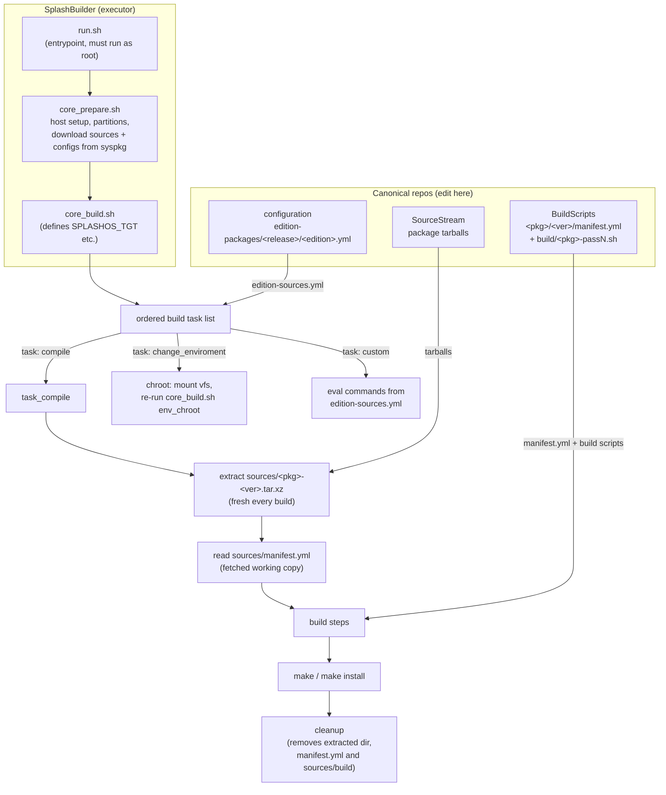

# Agent instructions for SplashOS / SplashBuilder

SplashOS is a from-source Linux distribution, modeled closely on
[LFS (Linux From Scratch)](https://www.linuxfromscratch.org/lfs/). The build is
driven by bash scripts and YAML manifests; packages are cross-compiled in
passes and then finished inside a chroot.

## Repository architecture

The project is split across multiple repositories. Know which repo a change
belongs in before editing:

| Repo | Purpose | What belongs here |
|---|---|---|
| `SplashBuilder` | **Build executor only.** Runs the build, fetches build configs from `syspkg.splashos.com` at build time. | Builder core scripts (`core_*.sh`, `prepare/`, `utils/`, `run.sh`), `config.yml`. **No package build configs.** |
| `BuildScripts` | Per-package build configs, served via syspkg. `BuildScripts/<package>/<version>/manifest.yml` + `build/<package>-passN.sh`. | All `configure`/`make` invocations, patches, per-package build fixes. |
| `configuration` | Edition / release configuration. `configuration/edition-packages/<release>/<edition>.yml` is served as `edition-sources.yml`. | Build order, package versions per edition, tasks. |
| `SourceStream` | Package source tarballs, served via syspkg. | Upstream sources only. **Never patch sources here** — fixes go in `BuildScripts`. |

Working copies of fetched build configs exist inside
`SplashBuilder/sources/` (`manifest.yml`, `build/*.sh`, `edition-sources.yml`)
and get overwritten on the next fetch/repack. Never use them as the place for
a fix — apply it in the canonical repo (`BuildScripts` or `configuration`).

## Build flow overview



Key environment variables (set in `run.sh` / `core_build.sh`, normally also in
`~/.bashrc` created by `prepare/modify_enviroment.sh`):

- `splash_partition_root` – target system root (default `/mnt/splashos`)
- `SPLASHOS_TGT` – cross target triple, e.g. `x86_64-splash-linux-gnu`
- `CONFIG_SITE` – cached configure results for cross-compilation

## Rule: fixes go in the canonical repos, never in working copies or sources

- Package build fixes (configure flags, patches, build steps) →
  `BuildScripts/<package>/<version>/`.
- Build order / task list / package versions → `configuration`.
- Builder behavior (env setup, task loop, chroot handling) → `SplashBuilder`.
- Extracted package sources (`SplashBuilder/sources/<package>-<version>/…`)
  are deleted and re-extracted from the tarballs on every build — editing them
  is always lost.

A per-package fix should be expressed as a change to the `configure`/`make`
invocation in the package's build script (e.g. passing a cache variable like
`gl_cv_func_strcasecmp_works=yes` to `configure`), or as a patch file
referenced from the package's `manifest.yml` (`build.<mode>.patch`).

## Recovery / build snapshots

SplashBuilder checkpoints the build after **every successful task** so an
interrupted build can be continued instead of wiping the build partition and
rebuilding everything:

- `$splash_partition_root/.build_state` — shell-sourceable state:
  `BUILD_STEP` (next top-level task index), `CHROOT_STEP` (next task index
  inside the chroot section), `SPLASHOS_TGT`, and an md5 of the
  `edition-sources.yml` used (guards against config changes between runs).
- `$splash_partition_root/.build_snapshot/` — the build config
  (`manifest.yml`, `build/`, `patch/`) of the task that was running when the
  build stopped; restored automatically when that task is re-run on recovery.
  It is only restored when the snapshot's package matches the resumed task
  and the working copy is missing, so injected configs are never clobbered.

The dotfile names are deliberate: they survive `rm -rf $splash_partition_root/*`
in `reset_enviroment.sh`, which removes them explicitly for fresh builds.

```mermaid
flowchart LR
    A[run.sh] -->|".build_state exists?"| B{"Recover?"}
    B -->|yes / "run.sh recover"| C["core_build.sh recover<br/>validate target + edition hash,<br/>resume at BUILD_STEP"]
    B -->|no| D["reset_enviroment.sh<br/>wipe partition + state"]
    D --> E["core_build.sh fresh"]
    C --> F["restore snapshot config<br/>for the resumed compile task"]
    E --> G["run task"]
    F --> G
    G -->|success| H["save_checkpoint<br/>BUILD_STEP = i + 1<br/>(CHROOT_STEP inside chroot)"]
    H --> G
    G -->|failure| I["stop; state keeps the<br/>resume point for next run"]
```

`core_build.sh` modes: *(no args / `fresh`)* fresh build with checkpoints,
`recover` resume from the last checkpoint,
`env_chroot <top-index> [chroot-step]` internal chroot phase (also resumable).
When the host-side run completes — or a rerun finds the build already
complete — a final **cleanup stage** removes the build leftovers from the
target partition (`core_build.sh`, `config.yml`, `edition-sources.yml`,
`sources/`, the cross toolchain `tools/`, and `.build_snapshot/`).
`.build_state` and `.build_logs` are kept: the state file makes further reruns
print "Build already complete" instead of wiping the partition.

## Conventions and gotchas learned in practice

- Never rely on `~/.bashrc` for build variables: it is only sourced by
  interactive shells, so `sudo ./run.sh` and the chroot `env -i` lose them.
  `run.sh` and `core_build.sh` now set/defaults these explicitly.
- Cross-compiling configure runs cannot execute test programs. When a build
  fails with `cannot run test program while cross compiling`, look up the
  failing check's cache variable in `config.log` (`ac_cv_*` / `gl_cv_*`) and
  pre-seed it in the package's build script in `BuildScripts` (`VAR=yes` on
  the configure command line), as done for diffutils 3.12.
- The `pop_var_context: head of shell_variables not a function context` bash
  message after a failure in `core_build.sh` is cosmetic fallout of `set -e`
  unwinding out of `task_compile`; fix the real build error instead.
- GCC pass 1 must always see a non-empty `SPLASHOS_TGT`, otherwise GCC
  configures as a native build and fails with
  `bootstrapping with --disable-libstdcxx is not supported`.
- **Re-run idempotency**: recovery re-runs tasks on a target tree that may
  already contain the package's files from a previous attempt. All install
  steps in BuildScripts must therefore be idempotent — use `ln -sfv` (not
  `ln -sv`, which the book uses because LFS assumes a fresh tree), and
  prefer force/overwrite variants for links and copies. A non-idempotent
  step fails with `File exists` on the second attempt (bzip2 did exactly
  that in the 14 Nov 2026 session).
- **syspkg is behind Cloudflare.** A repacked tarball keeps the same
  filename, so the CDN edge can serve a stale copy (old body *and* old
  `Last-Modified`) for a long time. This caused a "fixed but still failing"
  loop in the 14 Nov 2026 session (diffutils). Countermeasure in
  `prepare/dependencies.sh`: every request is cache-busted with
  `?seed=<run-timestamp>` (a fresh URL = CDN miss = origin truth), and
  freshness is decided by an explicit HEAD `Last-Modified` comparison
  (wget `-N` cannot be combined with a changing URL). Toggle with
  `download_cachebust` in `config.yml` (default on). Purging the CDN cache
  or short origin cache TTLs remain good hygiene for non-seeded consumers.
